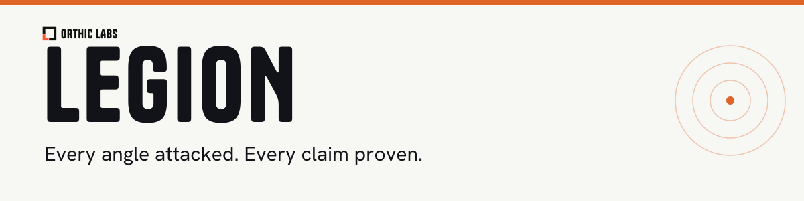
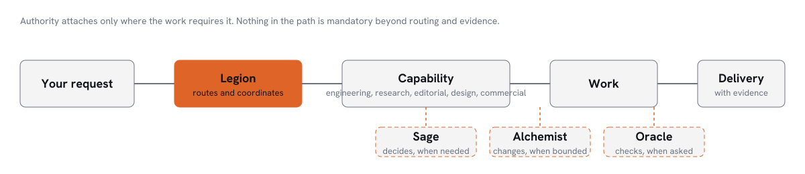
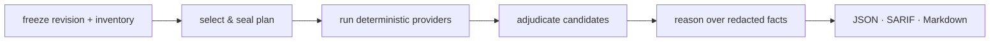

<picture><source media="(prefers-color-scheme: dark)" srcset=".github/banner-dark.svg"></picture>

# Legion

Legion routes AI-assisted engineering, research, editorial, design and commercial work to the right capability, keeps decisions, changes and independent checks separate, and records evidence before anything is called delivered. It is one doctrine projected into Claude Code, Codex or an `AGENTS.md` harness. Every angle attacked. Every claim proven.

## Set up

Public package-manager installation is not open yet. Current shipping contract is signed native Legion; Node package remains private development tooling. From a source checkout, Node 22.13+, pnpm, & Rust toolchain are required.

```sh
pnpm install --frozen-lockfile
cargo build --manifest-path engine/Cargo.toml --release --bin legion
engine/target/release/legion --version
```

After installing a signed release-bound binary through an approved channel:

```sh
legion setup --dry-run
legion setup --confirm
legion setup --check
```

Setup detects supported clients, previews exact persistent changes, projects canonical skills & MCP integration through registered host adapters, records rollback state, then verifies installed host-visible state. `setup --check` is read-only. `setup remove --confirm` removes Legion-owned projections while preserving user-owned config.

Claude Code receives packaged plugin surfaces. Codex receives canonical Agent Skills under `.agents/skills` plus MCP registration. Portable Agent Plugins receive one documented umbrella `legion` skill that routes internally; this is a fallback surface, not per-skill fidelity.

For repository audit:

```sh
legion audit .
legion verify .audit/<run>
```

Audit freezes a plan before execution, emits machine-readable evidence, & marks incomplete coverage as unproven rather than clean. Use `legion --help` for current commands.

## One request, end to end

Ask for a repository audit. Legion freezes the revision and file inventory, selects providers deterministically and seals a plan. The checks run. Security candidates are generated separately from the adjudication that judges them. The result is JSON, SARIF and Markdown, and a skipped required check, stale inventory, missing adjudication or unproven coverage prevents a clean verdict.

```sh
legion audit .
legion verify .audit/<run>
```

## Harnesses & fidelity

One doctrine & kernel project into harness-native slots. Legion does not pretend every host exposes identical controls.

| Capability | Claude Code | Codex | `AGENTS.md` readers |
|---|---|---|---|
| Doctrine & routing | yes | yes | yes |
| Native authority agents | yes | host-dependent | host-dependent |
| Guard pre-effect interception | when host hooks support it | when host hooks support it | boundary-gated |
| Receipts | decision returned to host; no persisted effect receipt yet | same | CLI/boundary; no persisted effect receipt yet |
| Council isolation | engine-owned | engine-owned | engine-owned |
| Oracle Completion Validation | yes | yes | yes |

Run `legion doctor` to inspect current repository, binding, coverage, & host state. Run `legion bind --registrations` to inventory installed hooks across settings & plugins and detect duplicate registrations.

## How work flows

<picture><source media="(prefers-color-scheme: dark)" srcset=".github/flow-dark.svg"></picture>

Legion begins with current user intent. Legion selects zero or more capabilities from compact public catalog, deterministic runtime validates IDs, & Legion materializes work graph. Legion attaches authority only where work requires it: Sage (optional) for cross-cutting design, reassessment, & material unresolved meaning/ownership/acceptance, Alchemist for bounded implementation (ambient unless work is locked or explicitly contracted), & Oracle (optional) for independent Completion Validation on explicit request or a concrete outcome or safety risk. Arcane owns cognitive processing & response policy. Guard deterministically gates typed effects, reports enforcement health, & owns effect-decision receipts; neither can invent consent.

Work splits into independent units where safe, then reunites at delivery. Capabilities supply expertise, method, workflow, & context; capability never grants authority. Optional domains group catalog entries for discovery only.

## Engineering cohort

| Component | Job | Cannot do |
|---|---|---|
| **Legion** | Interpret live intent, route work, coordinate lanes, report delivery state | Manufacture authority from assistant prose or hooks |
| **Sage** | Cross-cutting design, reassessment, & adjudication of material meaning, ownership, or acceptance | Own architecture, diagnosis, routine decisions, or implementation |
| **Alchemist** | Apply bounded implementation, repair mechanical failures, verify its work | Settle new engineering decisions |
| **Oracle** | Independently perform Completion Validation over requested outcome & evidence | Own Audit/QA/Audit Visual methods or certify its own fix |
| **Arcane** | Shape bounded cognitive processing & response policy | Select capabilities, attach authority, or authorize effects |
| **Guard** | Deterministically gate typed effects, report enforcement health, & own effect-decision receipts | Interpret intent, select capabilities, or attach authority |
| **Council** | Isolated challenge chamber over frozen evidence | Override caller authority |

Oracle is optional independent assurance authority for Completion Validation; it is never a delivery gate.

## Catalog grouping

Current catalog uses these optional discovery groups, not routing authorities or a fixed hierarchy:

- **Commercial** — marketing, advertising, social, SEO
- **Research** — general, scientific, & market evidence
- **Editorial** — writing & editorial work
- **Design** — interface, visual, & brand-identity work
- **Engineering** — architecture, diagnosis, QA, and platform development

Skills supply reusable methods. Legion owns semantic selection, work graph, evidence, & delivery state across all groups.

### Apple development

Use `/ios-development` for iOS/iPadOS and `/macos-development` for Mac applications or
their Apple-native components. Both are automatically discoverable engineering capabilities
with short entrypoints and task-selected references for SwiftUI, concurrency, testing,
persistence, performance, system integration, and release preparation. They preserve the
project's deployment targets, architecture, data layer, and any Rust/Tauri/Cargo host.

Each bundle is self-contained for native skill projection. Xcode, SwiftPM, and optional
build/UI/documentation/release adapters are checked only for the selected workflow; the
skills include official-source setup recipes and a read-only PATH preflight helper. Agents
detect and reuse tools, propose missing setup, then apply only authorized changes and verify.
CLI setup persists per environment and MCP registration per selected client scope, shared
by both skills. Loading a skill grants no installation, persistent-access, account, signing,
telemetry, upload, or publishing permission. See [packaged skills](docs/architecture/skills.md) and
[third-party notices](docs/THIRD_PARTY_NOTICES.md) for provenance and tool boundaries.

## Audit engine

Audit is one product capability inside Legion, not Legion's entire identity. It freezes repository revision & file inventory, selects providers deterministically, seals a plan, runs selected checks, keeps security-candidate generation separate from adjudication, & writes JSON, SARIF, plus Markdown output. A skipped required check, stale inventory, missing adjudication, or unproven coverage prevents a clean verdict.



## Repository

- [Architecture & doctrine](doctrine/legion.md)
- [Full manual](references/manual.md)
- [Provider architecture](references/provider-architecture.md)
- [Engine interface](references/engine-interface.md)
- [License](LICENSE)


## Repository truth docs

- [Canonical system architecture](docs/LEGION-CANONICAL-SSOT.md) — ownership boundaries and global invariants
- [Role architecture](docs/architecture/) — Sage, Alchemist, Oracle, packaged skills
- [Historical provenance](docs/provenance/) — frozen records that cite deleted code; not authoritative

## License

Source-available under the Orthic Labs Source Use License v1.0. See [LICENSE](LICENSE).

---

<picture><source media="(prefers-color-scheme: dark)" srcset=".github/orthic-labs-mark.svg"></picture> **[Orthic Labs](https://orthiclabs.com)** · [github.com/Orthic-Labs](https://github.com/Orthic-Labs) · More: [SellRight](https://github.com/Orthic-Labs/sellright) · [Ember](https://github.com/Orthic-Labs/ember) · [SwiftRight](https://github.com/Orthic-Labs/swiftright) · [Pulse](https://github.com/Orthic-Labs/pulse) · [RightKit](https://github.com/Orthic-Labs/rightkit) · [RustRight](https://github.com/Orthic-Labs/rustright)
